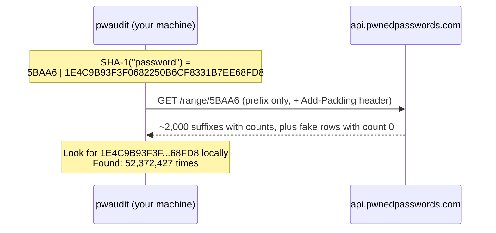

# pwaudit

[](https://github.com/BlazeXYZ/pwaudit/actions/workflows/tests.yml)


A command-line password auditor that answers two questions:

1. **How hard is this password to guess?** An entropy model that prices predictable structure (common passwords, keyboard walks, sequences, years, dictionary words) at what an attacker would actually spend on it, not at what the character count suggests.
2. **Has it already leaked?** A breach lookup against [Have I Been Pwned](https://haveibeenpwned.com/Passwords) using **k-anonymity**: the password is hashed locally and only the first 5 characters of the hash ever leave the machine.

Pure Python standard library, zero dependencies, Python 3.9+, tested on Linux, Windows and macOS.

---

## Contents

- [Demo](#demo)
- [Quick start](#quick-start)
- [Usage and options](#usage-and-options)
- [How the breach check works](#how-the-breach-check-works)
- [How the strength model works](#how-the-strength-model-works)
- [Design decisions and the alternatives I rejected](#design-decisions-and-the-alternatives-i-rejected)
- [Threat model: what this protects and what it does not](#threat-model-what-this-protects-and-what-it-does-not)
- [Testing strategy](#testing-strategy)
- [Project structure](#project-structure)
- [Limitations and future work](#limitations-and-future-work)
- [References](#references)

---

## Demo

```text
$ python -m pwaudit -f examples/sample_passwords.txt

[line 2]
  Length     12
  Charset    lower+upper+digit+symbol (pool 95)
  Entropy    78.8 bits raw, 10.0 bits effective
  Rating     Very weak (0/4)
  Crack time instantly (assumes 1e+11 guesses/s, offline attack on a fast hash)
  Breaches   FOUND 21,349 times in known breaches
  Findings
    - Contains a year, which is one of the first things attackers try
    - Matches a common password or a trivial variation of one

[line 6]
  Length     28
  Charset    lower+upper+digit+symbol (pool 95)
  Entropy    184.0 bits raw, 70.0 bits effective
  Rating     Strong (3/4)
  Crack time about 188 years (assumes 1e+11 guesses/s, offline attack on a fast hash)
  Breaches   not found in known breaches
  Findings
    - Built from 4 dictionary words, each guessable as one unit (~10.8 bits) rather than letter by letter

[line 7]
  Length     20
  Charset    lower+upper+digit+symbol (pool 95)
  Entropy    131.4 bits raw, 131.4 bits effective
  Rating     Excellent (4/4)
  Crack time over a billion years (assumes 1e+11 guesses/s, offline attack on a fast hash)
  Breaches   not found in known breaches

Summary: 7 audited, 5 weak or worse, 5 breached
```

Line 2 is `P@ssw0rd2024`. It uses all four character classes, so a naive checker would call it strong (78.8 bits). It is really `password` plus leetspeak plus a year, which is among the first things a cracker tries, and it appears in 21,349 breaches. That gap between **raw** and **effective** entropy is the point of the project.

Results are labelled by line number. The password itself is never printed, not even in part.

---

## Quick start

```bash
git clone https://github.com/BlazeXYZ/pwaudit.git
cd pwaudit
python -m pwaudit            # prompts for a password, input hidden
```

Nothing to install. To get a `pwaudit` command on your PATH instead:

```bash
pip install .
pwaudit --help
```

Run the tests:

```bash
python -m unittest -v
```

---

## Usage and options

```bash
python -m pwaudit                                   # interactive, hidden prompt
python -m pwaudit -f examples/sample_passwords.txt  # one password per line
cat passwords.txt | python -m pwaudit -f -          # read from stdin
python -m pwaudit -f passwords.txt --offline        # nothing leaves the machine
python -m pwaudit -f passwords.txt --json           # machine-readable output
python -m pwaudit --wordlist rockyou.txt            # bigger common-password list
python -m pwaudit --dictionary eff_large_wordlist.txt  # bigger word list for passphrases
```

| Option | Purpose |
| --- | --- |
| `-f PATH`, `--file PATH` | Audit one password per line. `-` reads stdin. Without it, a hidden prompt is used. |
| `--offline` | Skip the breach lookup. No network traffic at all. |
| `--json` | Emit a JSON array instead of the text report. |
| `--wordlist PATH` | Extra common passwords, merged with the built-in list. |
| `--dictionary PATH` | Word list for passphrase scoring. Replaces the built-in list. |
| `--timeout SECONDS` | Network timeout per request (default 10). |
| `--version` | Print the version. |

**Exit codes** make it usable in scripts and CI:

| Code | Meaning |
| --- | --- |
| `0` | Every password is at least Fair and was not found in any breach (or the check was skipped with `--offline`). |
| `1` | At least one password is Weak or worse, or was found in a breach. |
| `2` | Error: missing file, no input, cancelled, or the breach service was unreachable. |

If a password is both flagged and the network fails for another, `1` wins, because "you have a weak password" is the more important message.

---

## How the breach check works

Have I Been Pwned (HIBP) holds the SHA-1 hashes of about two billion passwords from real breaches. Sending a password, or even its full hash, to any third party would defeat the purpose of checking it. HIBP's range API solves this with **k-anonymity**:



1. **Hash locally.** `SHA-1(password)`, as 40 uppercase hex characters ([`breach.py`](pwaudit/breach.py), `sha1_parts`).
2. **Split.** The first 5 characters are the **prefix**, the other 35 are the **suffix**.
3. **Send only the prefix.** `GET https://api.pwnedpasswords.com/range/5BAA6`. Five hex characters are 20 bits, so there are 16⁵ = 1,048,576 possible prefixes.
4. **Receive the whole bucket.** HIBP returns every breached suffix that shares the prefix, with a count for each. When I measured `5BAA6` it held **1,978 real suffixes**.
5. **Match locally.** If our suffix is in the list, its count is the number of times the password appeared in breaches. Otherwise the answer is 0.

**What the server learns:** that the password is one of the ~2,000 breached hashes in that bucket, *or* one of the countless never-breached passwords that also hash to that prefix. That is the "k" in k-anonymity: the query is indistinguishable from the queries for every other password in the same bucket.

**Response padding.** Bucket sizes differ, so the size of the encrypted HTTPS response could hint at which prefix was asked for. The `Add-Padding: true` header tells HIBP to add fake rows with a count of 0, so responses look alike. My measured response grew from 1,978 to 2,130 rows (152 fake). This is why `count_in_range` treats a count of 0 as "not found" rather than "found zero times", and why there is a test for it.

**Request de-duplication.** In batch mode, passwords that share a prefix reuse one response from a per-run cache. This saves requests, and it means the server never sees the same prefix twice, so it cannot count how many passwords in your file fell into one bucket.

### Why SHA-1, when SHA-1 is "broken"?

SHA-1 is not being used here to protect anything. It is the format the HIBP dataset is published in, so the client must use it to compare. SHA-1's known weakness is **collisions** (two chosen inputs with the same hash, demonstrated by SHAttered in 2017). Collisions are irrelevant here. What matters is that the 20-bit prefix does not let anyone recover the password, and no collision attack changes that. The call passes `usedforsecurity=False` (Python 3.9+), which documents this intent and stops FIPS-mode systems from blocking the call.

---

## How the strength model works

All logic is in [`strength.py`](pwaudit/strength.py), in `analyze()`. The output is in **bits**, meaning log₂ of the number of guesses an attacker needs. Every bit added doubles the work.

### Step 1: raw entropy (the naive number)

Each character is assumed random from the pool of character classes used:

| Class | Pool added |
| --- | --- |
| lowercase `a-z` | 26 |
| uppercase `A-Z` | 26 |
| digits `0-9` | 10 |
| symbols (32 ASCII punctuation + space) | 33 |
| any non-ASCII character | 100 (a rough allowance) |

`raw bits = length × log₂(pool)`. For `password`: 8 × log₂(26) = **37.6 bits**. This is what most "strength meters" show, and it is wrong for any password a human chose, which is why it is reported but not used for the rating.

### Step 2: price predictable structure

The model keeps a cost per character, starting at log₂(pool), and lowers the cost of characters that an attacker can predict:

| Pattern | Detection | Cost |
| --- | --- | --- |
| Sequences (`abc`, `4321`) | 3+ characters each ±1 from the last | First character full price, the rest 1 bit each |
| Keyboard walks (`qwerty`, `poiu`) | 4+ characters along a keyboard row, either direction | First character full price, the rest 1 bit each |
| Repeats (`aaa`, `abcabc`) | A character 3+ times, or the whole password as a repeated block | Repeated part 1 bit per character |
| Years (`1987`, `2024`) | `19xx` or `20xx` not inside a longer number | 7 bits for the whole year (about 130 plausible years) |

### Step 3: price dictionary words (passphrases)

Someone attacking `correct horse battery staple` does not try 28 random characters. They try four words from a list. If the list has N words, each word costs log₂(N) bits, regardless of its length.

The built-in list ([`words.txt`](pwaudit/words.txt)) has 1,813 common English words of 4+ letters, so a word costs log₂(1813) ≈ **10.8 bits**. Then:

- **+1 bit** if capitalised as `Word` or `WORD`. Irregular capitals (`wOrD`) cost 1 bit per capital.
- **+1 bit** per leetspeak swap (`h0rse` matches `horse`).
- **Separators:** the first separator between words is full price. Repeats of it cost 1 bit, since passphrases nearly always reuse one separator.

The hard part is deciding where the words are. `CorrectHorseBatteryStaple` has no spaces, and a single string can be split many ways. `dictionary_words()` uses **dynamic programming**: `best[j]` is the cheapest cost of the first `j` characters. Each position either takes one character at its current cost, or jumps over a whole dictionary word at its word cost:

```
best[i+1] = min(best[i+1], best[i] + cost[i])                  # one character
best[j]   = min(best[j],   best[i] + word_bits(password[i:j])) # a word ending at j
```

It runs in O(n × L) time, where L is the longest word in the list. Because a word is only used when it is cheaper than the characters it covers, a random string is never made to look weaker than it is. Words shorter than 4 letters are ignored because they show up by chance inside random strings.

Worked example, `correct horse battery staple` (pool 59, so 5.88 bits per character):

| Part | Bits |
| --- | --- |
| 4 words × 10.8 | 43.3 |
| first space | 5.9 |
| 2 repeated spaces × 1 | 2.0 |
| **Effective** | **51.2** (Fair), down from 164.7 raw |

### Step 4: common passwords

If the password is on the common-password list, or becomes one after lowercasing, undoing leetspeak (`@`→`a`, `0`→`o`, `$`→`s`, …) and stripping trailing digits and symbols, the total is capped at **10 bits**, about the first thousand guesses. `Summer2024!` → `summer`. `P@ssw0rd` → `password`. `--wordlist rockyou.txt` adds a real list.

### Step 5: rating and crack time

| Effective bits | Rating | Score |
| --- | --- | --- |
| < 28 | Very weak | 0 |
| 28 – 35 | Weak | 1 |
| 36 – 59 | Fair | 2 |
| 60 – 79 | Strong | 3 |
| ≥ 80 | Excellent | 4 |

**Crack time** = 2^(bits − 1) ÷ 10¹¹ guesses per second. The −1 is the average case: an attacker finds the password after searching half the space on average. 10¹¹/s is roughly one current high-end GPU running hashcat against a fast unsalted hash such as MD5 or NTLM. The assumption is printed in every report, because crack time is meaningless without one. Against bcrypt or Argon2 the same password would take about a million times longer.

---

## Design decisions and the alternatives I rejected

### Privacy and security

| Decision | Alternative rejected | Why |
| --- | --- | --- |
| **k-anonymity range API** | Send the full SHA-1 hash to a lookup endpoint | An unsalted SHA-1 of a human password can be cracked in seconds. Sending the full hash is nearly the same as sending the password. |
| **k-anonymity range API** | Download the full HIBP dataset and check offline | That is the most private option, but it is tens of gigabytes and must be re-downloaded on every update. Wrong trade-off for a CLI tool. `--offline` covers people who want zero network traffic. |
| **Password never accepted as an argument** | `pwaudit --password hunter2` | Arguments are saved in shell history and visible to other users through the process list (`ps`, `/proc/<pid>/cmdline`, Task Manager). Input comes only from a hidden `getpass` prompt, a file, or stdin. |
| **Password never printed, not even in part** | Echo the password or matched fragments (`Keyboard pattern: 'qwerty'`) | Terminal output ends up in scrollback, CI logs and screenshots. Findings report lengths and counts instead. The passphrase finding says *how many* words it found, never *which*, because the words *are* the passphrase. Tests check this. |
| **Labels are line numbers** | Labels derived from the password (first characters, a hash) | Even a hash prefix in a log is a lead for an attacker. A line number is enough to find the entry in your own file. |
| **`Add-Padding` header** | Plain responses | Without it, response size can reveal which bucket was queried, even over HTTPS. |
| **Per-run prefix cache** | A request for every password | Fewer requests, and the server cannot see how many of your passwords share a bucket. |
| **Zero dependencies** | `requests`, `click`, `rich`, `zxcvbn` | Every dependency in a security tool is code that handles your passwords and could be compromised in the supply chain. The standard library covers HTTPS (`urllib`, which verifies certificates by default since PEP 476), hashing, argument parsing and hidden input. |
| **Strip a UTF-8 BOM from input** | Read the file as-is | Notepad and PowerShell can start files with an invisible BOM character. It gets hashed into the first password, which produces a wrong hash and a false "not found in breaches". This was a real bug, now covered by a test. |

### Strength model

| Decision | Alternative rejected | Why |
| --- | --- | --- |
| **Price patterns per character** | Pure `length × log₂(pool)` | The pure formula rates `P@ssw0rd2024` as stronger than a random 11-character lowercase string. People don't pick characters at random, and attackers know it. |
| **Price patterns per character** | Composition rules ("needs an uppercase, a digit and a symbol") | Composition rules push people toward `Password1!`. NIST SP 800-63B recommends against them. The tool reports character classes but never requires them. |
| **Dynamic programming for word splitting** | Split on spaces and hyphens only | Misses `CorrectHorseBatteryStaple` and `correct.horse`. DP finds the cheapest split wherever the words are, in linear time. |
| **Dynamic programming for word splitting** | Greedy longest match | Greedy can choose a long word that forces a worse split later. DP is guaranteed to find the cheapest split. |
| **Word cost = log₂(list size)** | Weight each word by how common it is (as zxcvbn does) | Frequency weighting is more accurate but needs a frequency-ranked corpus. A flat cost is simple to explain and to test, and `--dictionary` lets you change it. Listed under future work. |
| **Words of 4+ letters only** | Include 2–3 letter words | Short words occur by chance in random strings (`kXv9art…`) and would understate their strength. Leaving out `cat` in a passphrase overstates its strength slightly, which is the lesser error. |
| **Common-password cap of 10 bits** | Lower the score by a fixed amount | A password on a top-1000 list is guessed in the first ~1,000 tries whatever its length. A cap describes that directly. |
| **Own model** | Use `zxcvbn` | zxcvbn is the industry reference and a better estimator. This project exists to show the reasoning itself, and to avoid a dependency (see above). |
| **Stated attacker speed (10¹¹/s)** | An unlabelled "time to crack" | The true answer ranges from milliseconds (MD5) to centuries (bcrypt) depending on how the site stored it. Stating the assumption is the honest option. |
| **Effective ≤ raw, always** | Allow bonuses | Patterns can only make a password easier to guess. A test checks this invariant. |

### Engineering

| Decision | Alternative rejected | Why |
| --- | --- | --- |
| **`fetch` is injected** (`pwned_count(password, fetch=...)`) | Mock `urllib` in tests | Dependency injection keeps tests simple, deterministic and offline. It also allows a privacy test: a spy fetcher proves only the 5-character prefix is ever passed out. |
| **Three modules: strength, breach, cli** | One script | Strength scoring is pure (no I/O) and testable on its own. The breach client has one network function. The CLI is the only part that does I/O. Each can be reused, for example in a web service. |
| **Distinct exit codes** | Always exit 0 | Lets the tool gate a CI pipeline or a shell script. |
| **`--json` output** | Text only | Machine-readable output for pipelines. It carries the same privacy guarantees. |
| **Network failure reported, not fatal** | Crash, or silently report "not found" | Silently saying "not found" when the check never ran is the dangerous option. The report says `unavailable (...)` and the exit code is 2. |
| **`unittest`** | `pytest` | It is in the standard library, so there is nothing to install to run the tests. |

---

## Threat model: what this protects and what it does not

**Protects against**

- The breach service, or anyone watching the network, learning the password. Only 20 bits of an unsalted hash are sent, over HTTPS, padded.
- The password ending up in shell history, the process list, the terminal or logs.
- Overconfidence caused by naive entropy meters.

**Does not protect against**

- **A compromised machine.** Malware or a keylogger sees the password when you type it. Only audit real passwords on a machine you trust.
- **The prefix leaking some information.** The prefix narrows the password to about 1 in a million of all possible hashes. For a password that is *already breached*, an attacker who logs the prefix and knows the breach corpus can narrow the candidates to the ~2,000 entries in that bucket. Li et al. (CCS 2019) analysed this and proposed stronger protocols. For a password that was never breached, the bucket tells an attacker almost nothing useful.
- **Memory.** Python strings are immutable and cannot be reliably wiped from memory after use. A tool written in C or Rust could zero its buffers.
- **Being a guarantee.** "Not found" means "not in HIBP's corpus", not "never leaked". The strength score is an estimate under one attacker model.

---

## Testing strategy

`python -m unittest -v` runs 37 tests in under a second, with no network access. A fake HIBP that returns realistic padded responses replaces the network.

| Area | What is checked |
| --- | --- |
| Hashing | The known SHA-1 test vector for `password`, and the 5/35 prefix/suffix split. |
| Protocol | Found, not found, padding rows (count 0) mean "not found", a malformed response raises an error. |
| **Privacy** | A spy fetcher proves only the 5-character prefix leaves. Text and JSON output never contain the password. Findings never quote fragments of it. The passphrase finding never names the words. `--offline` makes zero network calls. |
| Robustness | Network failure becomes a report and exit 2. Missing file. Same prefix fetched once. A UTF-8 BOM is not hashed into the password. |
| Strength model | Pool sizes, sequences, keyboard walks, repeats, years, leetspeak, common-password variants, word splitting with and without separators, capitalisation and leet costs, custom dictionaries, and the invariant effective ≤ raw. |

GitHub Actions runs the suite on Ubuntu (Python 3.9 and 3.13), Windows and macOS, plus an end-to-end CLI smoke test.

---

## Project structure

```text
pwaudit/
├── pwaudit/
│   ├── __init__.py      version
│   ├── __main__.py      enables `python -m pwaudit`
│   ├── breach.py        HIBP k-anonymity client: hashing, request, response parsing
│   ├── strength.py      entropy model, pattern detection, passphrase DP
│   ├── words.txt        built-in word list (1,813 words) for passphrase scoring
│   └── cli.py           argument parsing, input, output, exit codes
├── tests/
│   ├── test_breach.py   protocol, privacy and CLI tests (fake HIBP)
│   └── test_strength.py strength model tests
├── examples/
│   └── sample_passwords.txt
├── .github/workflows/tests.yml
├── pyproject.toml
└── LICENSE
```

Data flow for one password:

```text
cli.read_passwords ──► strength.analyze ──────────────────────────► StrengthResult
                  └──► breach.pwned_count ─► sha1_parts ─► fetch(prefix) ─► count_in_range
                                                              (cached per prefix)
                                     both ─► cli.render_text / JSON ─► exit code
```

---

## Limitations and future work

- **Word frequency.** Every word in the list costs the same. Weighting by rank (`the` cheaper than `lantern`), as zxcvbn does, would be more accurate.
- **Word list coverage.** A word missing from the list is priced letter by letter, so the score is too high. `--dictionary` with a larger list (such as EFF's 7,776-word diceware list) helps.
- **English only.** Words, keyboard rows (QWERTY) and leetspeak are all English-centric.
- **Names, dates and personal information.** `jordan1995` is caught (common list + year), but `dd/mm/yyyy` dates and names in general are not.
- **Stronger privacy protocol.** Frequency-smoothing bucketisation or private set intersection (as in Google's Password Checkup) would leak less than a hash prefix, but HIBP does not offer them.
- **NTLM mode.** HIBP also serves NTLM hashes. That would allow auditing hashes exported from Active Directory without ever handling the plaintext.

---

## Ethics and scope

Audit your own passwords, or passwords you are authorised to assess. This tool does no guessing or cracking. It only estimates and looks things up.

---

## References

- Troy Hunt, *I've Just Launched "Pwned Passwords" V2 With Half a Billion Passwords for Download* (2018). Introduces the k-anonymity range API.
- Cloudflare blog, *Validating Leaked Passwords with k-Anonymity* (2018). Explains the protocol design.
- HIBP API documentation, *Pwned Passwords* section: range endpoint and `Add-Padding`.
- L. Li, B. Pal, J. Ali, N. Sullivan, R. Chatterjee, T. Ristenpart, *Protocols for Checking Compromised Credentials*, ACM CCS 2019.
- D. L. Wheeler, *zxcvbn: Low-Budget Password Strength Estimation*, USENIX Security 2016.
- NIST SP 800-63B, *Digital Identity Guidelines: Authentication and Lifecycle Management*.
- M. Stevens et al., *The first collision for full SHA-1* (SHAttered), CRYPTO 2017.
- PEP 476, *Enabling certificate verification by default for stdlib http clients*.

## License

[MIT](LICENSE)
